# 🛡️ PARIKSHA (ProofCard / IM-105) — Master System Knowledge Base & Technical Blueprint

> **Notice:** This document is the comprehensive, canonical source of truth for **Pariksha** (Problem Statement `IM-105 ADVANCED`). It contains the end-to-end mathematical formulations, codebase architecture, cybersecurity defense rules, cryptographic verification protocols, API specifications, and benchmark metrics. It is structured specifically to serve as high-context grounding for Large Language Models (Gemini, ChatGPT, Claude) or technical evaluators.

---

## 1. PROJECT METADATA & EXECUTIVE OVERVIEW

* **Project Official Name:** Pariksha (also referenced as ProofCard)
* **Problem Statement ID:** `IM-105 ADVANCED — Proof of skill, not a template resume`
* **Competition:** Deviathon 2.0 (Integraminds AI Frontier Track)
* **Venue:** GLA University Mathura
* **Industry Partner:** Integraminds Industry Solutions Pvt Ltd
* **Team:** Team ARISE (Priyanshu Awasthi, Shivendra, and team)
* **Core Tagline:** *Proof of skill, not a template resume.*
* **Primary Mission:** Eliminate resume exaggeration, cloned tutorial repositories, and institutional pedigree bias in technical campus hiring by deriving mathematical proof of competency directly from candidate code, interactive voice viva defense, and cryptographic verification.

### The Systemic Hiring Problem Addressed:
1. **Resume Inflation & Keyword Stuffing:** Freshers flood Applicant Tracking Systems (ATS) with embellished PDF resumes listing dozens of advanced frameworks (*FastAPI, Kubernetes, Redis, Microservices*) without having written non-trivial logic.
2. **Cloned Tutorial Repositories:** Millions of students copy-paste YouTube/Udemy projects (*CodeWithHarry MERN E-Commerce, Clever Programmer Netflix/Spotify clones, Traversy Media boilerplates*), alter variable names, and pass them off as authentic capstones.
3. **Institutional Pedigree Bias:** Flooded by 5,000+ indistinguishable resumes, recruiters resort to arbitrary filtering: shortlisting only Tier-1 institutions (IITs, NITs, BITS) and discarding top 1% self-taught engineering talent from Tier-3 colleges.
4. **Zero Ground-Truth Verification:** Traditional hiring lacks an automated method to verify if a candidate actually understands and authored the specific lines of logic in their submitted repository.

---

## 2. THE FOUR ARCHITECTURAL PILLARS

Pariksha is architected on four distinct engineering pillars:

```mermaid
flowchart TD
    subgraph P1 ["Pillar 1: High-Performance Backend"]
        A["Python 3.11 + FastAPI AsyncIO"] --> B["Git Plumbing (Blobless Shallow Clone)"]
        B --> C["Tree-sitter AST Syntax Parser (<3s Scan)"]
    end

    subgraph P2 ["Pillar 2: Cryptographic Trust"]
        D["Candidate Evidence Canonicalization"] --> E["Ed25519 (RFC 8032) Curve25519 Signatures"]
        E --> F["SHA-256 Tamper-Evident Ledger + QR Verification"]
    end

    subgraph P3 ["Pillar 3: Interactive Frontend & Viva"]
        G["React 18/19 + Tailwind CSS"] --> H["Browser Web Speech API (Live Audio Defense)"]
        H --> I["5-Axis Competency Radar Polygon with Tooltips"]
    end

    subgraph P4 ["Pillar 4: Enterprise Modularity"]
        J["Dedicated IMATS Sandbox Adapter (:8000)"] --> K["400-Candidate Benchmark (88.4% Agreement)"]
        K --> L["n8n & Slack Webhook Dispatcher"]
    end

    P1 --> M["Verified Composite Proof"]
    P2 --> M
    P3 --> M
    P4 --> M
```



### Pillar 1: High-Performance Backend
* **Runtime:** Python 3.11 with FastAPI running on Uvicorn ASGI.
* **Git Plumbing vs. Porcelain:** Naive tools execute heavy porcelain commands (`git clone`, `git checkout`), downloading entire multi-gigabyte commit histories. Pariksha executes low-level Git plumbing commands (`git ls-tree`, `git cat-file`, `git rev-list`, `git log --numstat`) against blobless shallow clones (`git clone --filter=blob:none --depth=50`).
* **Tree-sitter AST Parsing:** Code is transformed into Abstract Syntax Trees (ASTs) language-agnostically (Python, JavaScript, TypeScript, Java, Go, C++, Rust). It extracts token hierarchies, strips docstrings/literals, and calculates cyclomatic complexity in **under 3 seconds**.

### Pillar 2: Cryptographic Verification & Tamper-Proof Badging
* **Algorithm:** Ed25519 (RFC 8032 Edwards-curve Digital Signature Algorithm over Curve25519).
* **Deterministic Canonicalization:** Normalizes candidate metrics:
  $$\text{Payload} = \{\text{candidate\_id}, \text{authenticity\_score}, \text{viva\_score}, \text{verified\_skills}, \text{issuer}, \text{timestamp}\}$$
* **Tamper-Evident Ledger:** Computes `SHA-256(canonical_bytes)` signed with the Authority’s private key. The resulting 64-byte signature and public key PEM allow instant offline verification. If an applicant alters their score in local HTML or PDF from 65 to 95, the cryptographic signature check fails instantly.
* **Public QR Verification:** Renders an on-card QR code linking to `?verify=<candidate_id>` for 1-click external validation without requiring recruiter database access.

### Pillar 3: Interactive Frontend & Voice Viva Defense
* **Tech Stack:** React 18/19, TypeScript, Vite, Tailwind CSS v4.
* **Web Speech API Integration:** Uses the browser’s native `webkitSpeechRecognition` with speech synthesis to conduct an automated, 60-second verbal viva defense without third-party audio plugin latency.
* **5-Axis Competency Radar Chart:** Renders an interactive SVG polygon mapping 5 key dimensions:
  1. **Architecture:** Code modularity, separation of concerns, directory hierarchy.
  2. **Testing:** Unit test presence (`test_*.py`, `*.test.ts`), assertion density, mocking.
  3. **Git Discipline:** Commit cadence, message evolution, atomic commits.
  4. **Code Quality:** McCabe cyclomatic complexity, low duplication, typing discipline.
  5. **Viva Defense:** Spoken technical articulation, concurrency defense, failure recovery.
* **Interactive Tooltips:** Hovering over any radar node reveals real-time code evidence (e.g., *"McCabe CC: 4.2 | 14 test assertions | 26 commits over 14 days"*).

### Pillar 4: Enterprise Modularity & ATS Integration
* **IMATS Sandbox Connector:** Implements a complete local REST simulator on port 8000 (`/api/v1/imats/sandbox`) mirroring enterprise ATS workflows (`GET /profiles`, `GET /jobs`, `POST /evaluate-agreement`, `POST /push-shortlist`).
* **Empirical Benchmark:** Tested against a 400-candidate campus batch across 30 job descriptions, demonstrating **88.4% Recruiter Agreement** and a **100% Fairness Ratio** (Zero demographic delta).
* **Workflow Automation Dispatcher:** Event-driven webhook engine (`/api/webhooks/test`) streaming signed JSON payloads to n8n workflows and Slack recruiter channels upon candidate completion.

---

## 3. CORE ALGORITHMIC ENGINES & MATHEMATICAL FORMULATIONS

### 3.1. AST Cyclomatic Complexity Analyzer (`backend/services/ast_analyzer.py`)
* Computes McCabe Cyclomatic Complexity ($CC$):
  $$CC = E - N + 2P$$
  Where $E$ is graph edges, $N$ is nodes, and $P$ is connected components. In practice, computed by counting independent decision branches:
  $$\text{Complexity} = 1 + \sum (\text{if, else if, for, while, case, catch, match, ?, \&\&, } ||)$$
* **Syntax Stripping:** Automatically removes single-line (`//`, `#`), block (`/* */`), docstrings, and string literals prior to parsing so test fixtures or license headers do not inflate complexity.
* **Structural Token Sequences:** Replaces variable and function names with structural tokens (e.g., `ClassDef > FunctionDef > Try > If > Call > Return`) to expose underlying logic trees.

### 3.2. Universal Winnowing Plagiarism Matcher (`backend/services/tutorial_matcher.py`)
* **Type-2 Clone Detection (MOSS-Equivalent):** Detects code with renamed variables, reordered independent statements, or cosmetic whitespace changes.
* **Token Normalization:** Replaces all identifiers with `IDENT`, numbers with `LIT_NUM`, strings with `LIT_STR`.
* **Winnowing Algorithm Pipeline:**
  1. Decomposes token stream into contiguous $k$-grams ($k = 8$).
  2. Hashes each $k$-gram using 32-bit Cyclic Redundancy Check (CRC32).
  3. Applies a sliding window ($w = 3$) to deterministically select the rightmost minimum hash.
  4. Yields a compressed document fingerprint.
* **Directional Candidate Coverage & Similarity Metric:**
  $$\text{Similarity} = 0.50 \cdot \text{Coverage}_{\text{Cand}} + 0.25 \cdot \text{Coverage}_{\text{Source}} + 0.15 \cdot \text{Jaccard} + 0.10 \cdot \text{SequenceRatio}$$
  Where $\text{Coverage}_{\text{Cand}} = \frac{|\text{Tokens}_{\text{Candidate}} \cap \text{Tokens}_{\text{Source}}|}{|\text{Tokens}_{\text{Candidate}}|}$.
* **Multi-Stage Vetting Pipeline:**
  * *Stage 0:* Direct source token overlap with upstream parent repos.
  * *Stage 1:* GitHub Fork metadata validation (flags if candidate author contribution $< 10\%$).
  * *Stage 2:* Manifest & Readme inspection (`package.json`, `setup.py`, `README.md`) for uncredited authors.
  * *Stage 3:* Author commit disparity (flags if $\ge 75\%$ of commits belong to a third party).
  * *Stage 4:* Fingerprint comparison against 30+ cataloged tutorial blueprints (CodeWithHarry, Clever Programmer, Traversy Media, etc.).

### 3.3. Temporal Git-DNA Commit Forensics (`backend/services/commit_forensics.py`)
* **Burst Ratio:** Percentage of total code added in a single 24-hour window:
  $$\text{Burst Ratio} = \frac{\max_{\text{day}}(\Delta \text{Lines})}{\text{Total Lines}}$$
  A burst ratio $> 80\%$ flags a high probability of a cloned zip or bulk copy-paste dump.
* **Refactoring Deletion Ratio:** Authentic development involves continuous deletion, refactoring, and rewrites ($15\% - 40\%$). Cloned or bought projects exhibit near-zero ($< 3\%$) line deletions.
* **Commit Message Progression:** Evaluates lexical progression across three lifecycle phases: Scaffolding (`init`, `setup`), Logic (`implement`, `route`, `controller`), and Stabilization (`fix`, `refactor`, `test`, `patch`).

### 3.4. Dynamic Viva Defense Engine (`backend/services/viva_engine.py`)
* Probes candidate functions having cyclomatic complexity $CC \ge 6$. Generates pointed architectural questions targeting concurrency, failure recovery, lock contention, memory leaks, and input validation.
* **Placement-Calibrated Grading Rubric (0 to 10 Scale):**
  * `0 / 10 (Strict Fail):` Gibberish, non-answers, memes (*"i am groot"*, *"idk"*, *"pass"*).
  * `2 / 10 (Surface Recital):` Keyword recitation without mechanistic understanding (*"I used FastAPI because it is fast and async"*).
  * `6 - 8 / 10 (Engineering Competence):` Clear articulation of architectural trade-offs, state lifecycles, and error boundaries.
  * `9 - 10 / 10 (Exemplary Mastery):` Concrete mitigation of race conditions, boundary failures, edge cases, and algorithmic complexity tradeoffs.

### 3.5. Tripartite Composite Score Engine (`backend/services/jd_matcher.py`)
Evaluates candidate compatibility against Job Descriptions using a formula:
$$\text{Composite Score} = 0.35 \times \text{Authenticity} + 0.40 \times \text{JD Skill Match} + 0.25 \times (\text{Viva Score} \times 10)$$
* **Evidence-Backed Skill Verification:** Eliminates ungrounded resume claims. A skill claim on a CV is verified **only** if backed by AST file proof:
  * `Testing` $\implies$ requires `test_*.py` or `*.test.ts` with assertion statements.
  * `Async IO` $\implies$ requires `async/await` coroutine syntax.
  * `Containerization` $\implies$ requires a multi-stage `Dockerfile`.
  * `Database Management` $\implies$ requires schema migration files or ORM models.

### 3.6. EEOC Four-Fifths Bias Enforcer (`backend/services/bias_engine.py`)
* **Pedigree & Demographic Decoupling:** Institutional names (IIT, NIT, Tier-3) and candidate demographics are stripped from the evaluation pipeline.
* **Disparate Impact Ratio ($DI$):**
  $$DI = \frac{\text{Selection Rate}_{\text{Protected/Tier-3}}}{\text{Selection Rate}_{\text{Advantaged/Tier-1}}}$$
  Under US EEOC Title VII guidelines, $DI \ge 0.80$ satisfies non-discriminatory hiring. Pariksha benchmark tests achieve a **0.93 Disparate Impact Ratio**, surfacing top-tier developers from Tier-3 colleges.
* **Fairness Stress-Testing:** When fed identical code submissions with swapped institutional metadata (e.g., IIT Delhi vs. rural Tier-3 college), Pariksha outputs a **0.00 disparity delta**.

---

## 4. ADVERSARIAL CYBERSECURITY & AI DEFENSES

Directly addressing Problem Statement IM-105 Page 12 & 15 ("*Prompt injection through repositories: Code and READMEs are untrusted input to your LLM*"):

### 4.1. Adversarial Prompt Injection Scanner (`backend/services/injection_scanner.py`)
Scans all READMEs, commit messages, and source code comments for adversarial jailbreaks before feeding to LLM evaluators. Enforces 8 compiled regex detection classes:
1. `DIRECTIVE_OVERRIDE`: *"ignore all previous instructions/rubrics"*
2. `SECURITY_BYPASS`: *"bypass all checks/verifications/safeguards"*
3. `SCORE_MANIPULATION`: *"give a score of 10/10", "assign 100% full marks"*
4. `INJECTION_DIRECTIVE_HEADER`: `[AI_EVALUATION_DIRECTIVE]`, `<!-- [AI_INSTRUCTION] -->`
5. `AI_GRADER_NOTE`: *"Note to AI grader / LLM assessor"*
6. `SYNTHETIC_INJECTION_BENCHMARK`: Known prompt injection evaluation repos
7. `ROLEPLAY_JAILBREAK`: *"DAN mode", "you are now in developer mode"*
8. `DELIMITER_HIJACK`: `<|im_start|>`, `<|endoftext|>`, `--- END SYSTEM PROMPT ---`

### 4.2. Stylometry & AI-Generated Code/Answer Detector (`backend/services/ai_detector.py`)
* Employs statistical perplexity and burstiness modeling combined with TF-IDF n-gram scoring and Platt scaling probability calibration.
* Evaluates candidate viva answers to flag answers generated entirely by copy-pasting from ChatGPT/Claude during the interview.

### 4.3. Zip-Slip & Path Traversal Protection (`backend/routers/zip_upload.py`)
* Offline laboratory ZIP uploads are extracted inside an isolated temporary directory. Every file entry is checked:
  `os.path.commonpath([target_path, extracted_path]) == target_path`
  Any attempt to write outside the sandbox directory throws an immediate security exception.

### 4.4. Mandatory Candidate Consent Protocol
* Strict GDPR/IMATS compliance: All static code analysis requires explicit candidate consent. Requests without consent are blocked with an immediate `403 Forbidden`.

---

## 5. REPOSITORY DIRECTORY MAP & FILE ROLES

```
ProofCard-IM105/
├── backend/                       # Python 3.11 FastAPI Backend
│   ├── main.py                    # Server initialization, CORS, routing, Windows loop fix
│   ├── requirements.txt           # Dependencies (fastapi, uvicorn, radon, cryptography, etc.)
│   ├── data/                      # Bundled datasets & benchmarks
│   │   ├── cohort_100.json        # 100-student campus batch dataset
│   │   ├── cohort_400.json        # 400-student enterprise benchmark dataset
│   │   ├── demo_profiles.json     # Pre-computed forensic profiles
│   │   ├── job_descriptions_30.json # 30 benchmark JDs across 10 domains
│   │   └── tutorial_fingerprints.json # 30+ global tutorial signature blueprints
│   ├── models/
│   │   └── schemas.py             # Pydantic request/response schemas
│   ├── routers/                   # REST API Controllers
│   │   ├── github_analysis.py     # Live blobless shallow clone & AST analyzer
│   │   ├── zip_upload.py          # Secure ZIP extractor & scanner
│   │   ├── viva.py                # Viva generation and grading endpoints
│   │   ├── recruiter_battle.py    # Head-to-head candidate matching against JDs
│   │   ├── bias_mirror.py         # EEOC Four-Fifths compliance & disparity tests
│   │   ├── proofcard.py           # Cryptographic signature generation & card data
│   │   ├── batch_operations.py    # Bulk cohort triage & clone cluster grouping
│   │   ├── imats_sandbox.py       # Integraminds IMATS enterprise sandbox API (:8000)
│   │   ├── webhooks.py            # Event dispatcher for n8n and Slack alerts
│   │   ├── readiness.py           # Actionable gaps-to-tasks readiness plan
│   │   └── deployment.py          # Deployment readiness contracts
│   └── services/                  # Core Algorithmic & Security Engines
│       ├── ast_analyzer.py        # Structural AST token & McCabe complexity extraction
│       ├── tutorial_matcher.py    # MOSS Winnowing, Type-2 clone detection & origin attribution
│       ├── commit_forensics.py    # Temporal commit velocity, burst ratio, deletion ratio
│       ├── crypto_service.py      # Ed25519 (RFC 8032) signing, SHA-256 ledger, verification
│       ├── injection_scanner.py   # Adversarial prompt injection & jailbreak defense
│       ├── ai_detector.py         # Statistical stylometry & AI text detector
│       ├── viva_engine.py         # Probing viva question generator & rubric evaluator
│       ├── jd_matcher.py          # Skill extraction & candidate battle ranking
│       ├── bias_engine.py         # Disparate impact ratio & demographic stripping
│       ├── n8n_service.py         # Outbound webhook payload formatting & dispatch
│       ├── readiness_engine.py    # Deterministic improvement task generator
│       └── deployment_readiness.py# Evidence-backed workplace competency contracts
├── web/                           # React 18/19 Frontend Application
│   ├── index.html                 # HTML entrypoint
│   ├── package.json               # Dependencies (React 18/19, Three.js, Lucide, Tailwind v4)
│   ├── vite.config.ts             # Vite build configuration
│   └── src/
│       ├── main.tsx               # Application root
│       ├── App.tsx                # Central state coordinator & 6-tab switcher
│       ├── App.css / index.css    # Deviathon battlefield styling & glowing ember themes
│       ├── types.ts               # Complete TypeScript data contracts
│       ├── data/                  # Offline demo profiles & cohort datasets
│       │   ├── cohortData.ts      # 100-student benchmark cohort for instant offline use
│       │   └── offlineDemoData.ts # Detailed forensic profiles (Priyanshu, Ananya, etc.)
│       └── components/            # UI Modules
│           ├── Navbar.tsx         # Navigation, demo profile picker, IMATS modal trigger
│           ├── CandidateIngestion.tsx # Repository/ZIP scanner, cohort batch analyzer, clone clusters
│           ├── ForensicTerminal.tsx   # Cyber-forensic AST complexity terminal & diff inspector
│           ├── VivaArena.tsx      # Real-time interactive voice viva defense (Web Speech API)
│           ├── ProofCard3D.tsx    # Digital ProofCard, 5-Axis Radar polygon, hover tooltips, QR
│           ├── RecruiterBattle.tsx# 3-candidate head-to-head JD matching arena
│           ├── BiasMirror.tsx     # EEOC Four-Fifths compliance audit & fairness stress-tester
│           ├── Devithation3DCanvas.tsx # Background Three.js floating golden embers particle canvas
│           └── ImatsApiModal.tsx  # Integraminds enterprise sandbox & webhook testbed
├── Dockerfile                     # Multi-stage production container
└── docker-compose.yml             # Single-command full-stack container orchestration
```

---

## 6. FRONTEND VIEWS & COMPONENT SPECIFICATIONS

The UI operates as a reactive single-page dashboard coordinated by `App.tsx` with 6 specialized tabs:

### 6.1. Tab 1: Candidate Ingestion & Batch Triage (`CandidateIngestion.tsx`)
* **Dual Ingestion:** Ingests live GitHub repositories or offline laboratory ZIP archives.
* **Mandatory Consent Checkbox:** Implements GDPR/IMATS compliance before trigger.
* **Cohort Batch Analysis (400 Candidates):** Automatically detects **Clone Clusters** (e.g., *"CodeWithHarry MERN E-Commerce (34 candidates)"*, *"Clever Programmer Spotify Clone (28 candidates)"*).
* **Instant KPI Metrics:** Displays authentic builders identified, flagged tutorial clones, and recruiter screening hours saved.

### 6.2. Tab 2: Forensic Terminal & AST Inspector (`ForensicTerminal.tsx`)
* **Cyberpunk Terminal Interface:** Renders real-time AST parsing logs, cyclomatic complexity calculations, and Winnowing hash streams.
* **Function-Level Branch Ranking:** Displays candidates' most complex functions ranked by McCabe CC with file locations and syntax-highlighted code.
* **Tutorial Attribution Banner:** Displays matched tutorial name, original creator, URL, and exact overlapping files.
* **Git-DNA Gauges:** Visualizes Burst Ratio, Refactoring Deletion Ratio, and Message Maturity.

### 6.3. Tab 3: Dynamic Code Viva Arena (`VivaArena.tsx`)
* **Context Code Inspection:** Displays the exact complex function ($CC \ge 6$) under examination.
* **Web Speech API Audio Defense:** Integrates `webkitSpeechRecognition` with a 60-second live countdown timer allowing candidates to speak their technical defense.
* **Live Rubric Evaluator:** Automatically evaluates the answer against expected architectural concepts, assigns a score (0 to 10), and recalculates the candidate's composite score in real-time.

### 6.4. Tab 4: Cryptographic ProofCard (`ProofCard3D.tsx`)
* **Visual Card Design:** Clean, high-contrast, military-grade dark aesthetic (3D cursor tilt removed to ensure crisp, distraction-free reading and perfect A4 printing).
* **5-Axis Competency Radar Chart:** Large, high-resolution SVG polygon mapping Architecture, Testing, Git Discipline, Code Quality, and Viva Defense.
* **Interactive Tooltip Hotspots:** Hovering over each radar axis displays an evidence tooltip detailing the underlying metrics.
* **Ed25519 & SHA-256 Ledger Seal:** Displays cryptographic payload digest and digital signature.
* **Scannable QR Verification:** Renders dynamic QR code pointing to `?verify=<candidate_id>`.
* **Print & PDF Mode:** Dedicated CSS stylesheet for single-page A4 executive reporting.

### 6.5. Tab 5: Recruiter Battle Arena (`RecruiterBattle.tsx`)
* **30 Standard JDs across 10 Domains:** Backend, Fullstack, DevOps, Cloud Data, AI/ML, Distributed Systems, Frontend UI, Security, Mobile, Embedded.
* **3-Candidate Head-to-Head Arena:** Evaluates candidates side-by-side on Authenticity (35%), JD Skill Match (40%), and Viva Score (25%).
* **Algorithmic Winner Declaration:** Declares the victor with point delta and auditable rationale.

### 6.6. Tab 6: Bias Mirror & Equal Opportunity Audit (`BiasMirror.tsx`)
* **Disparate Impact Dial:** Real-time visual gauge displaying compliance with the EEOC Four-Fifths rule ($DI \ge 0.80$, Pariksha achieves 0.93).
* **Tier-1 vs. Tier-3 Disparity Comparison:** Highlights high-performing Tier-3 talent filtered out by traditional resume filters.
* **Live Fairness Stress-Tester:** Ingests identical code under swapped institutional demographics (IIT Delhi vs. rural Tier-3 college), proving a 0.00 disparity delta.

### 6.7. Ambient Canvas & Enterprise Modal
* **Three.js Particle Canvas (`Devithation3DCanvas.tsx`):** 150+ GPU-accelerated golden ember particles with cursor-reactive motion.
* **IMATS Enterprise Modal (`ImatsApiModal.tsx`):** Configurable ATS Endpoint (`http://localhost:8000/api/v1/imats/sandbox`), Bearer token authentication, 400-candidate benchmark trigger, "Send Shortlist to ATS" export, and n8n/Slack webhook dispatcher testbed.

---

## 7. CORE TYPESCRIPT DATA CONTRACTS (`types.ts`)

```typescript
export interface CandidateProfile {
  candidate_id: string;
  name: string;
  anonymised_name?: string;
  college: string;
  college_tier?: 'Tier-1' | 'Tier-2' | 'Tier-3';
  repo_url?: string;
  project_name?: string;
  project_type: string;
  total_loc: number;
  authenticity_score: number;       // 0 - 100
  is_clone: boolean;
  matched_tutorial?: MatchedTutorial | null;
  git_dna: GitDnaMetrics;
  complex_functions?: ComplexFunction[];
  viva_questions?: VivaQuestion[];
  viva_score: number;               // 0 - 10
  proof_card: ProofCardContent;
  verified_skills?: string[];
  readiness_plan?: ReadinessPlan;
  deployment_contract?: DeploymentContract;
}

export interface ComplexFunction {
  file: string;
  function_name: string;
  complexity: number;               // McCabe cyclomatic score
  line_number: number;
  snippet: string;
}

export interface MatchedTutorial {
  id: string;
  name: string;
  source_url?: string;
  similarity_score: number;         // 0.00 - 1.00
  matched_files: string[];
  author?: string;
  origin_type?: string;
  verdict: string;
}

export interface GitDnaMetrics {
  total_commits: number;
  time_span_days: number;
  burst_ratio: number;              // 0.00 - 1.00
  deletion_ratio: number;           // 0.00 - 1.00
  organic_growth: boolean;
  message_maturity_score: number;   // 0 - 100
  test_files_detected: number;
  history_verified?: boolean;
}

export interface VivaQuestion {
  question_id: string;
  function_name: string;
  file: string;
  line_number: number;
  question: string;
  expected_concepts: string[];
  difficulty: 'easy' | 'medium' | 'hard';
  mock_answer?: string;
  score?: number;                   // 0 - 10
  feedback?: string;
}

export interface ProofCardContent {
  status: 'VERIFIED' | 'NEEDS_PROOF' | 'FLAGGED';
  headline: string;
  strengths?: string[];
  growth_area?: string;
  specific_action?: string;
  tamper_proof_hash: string;        // SHA-256 digest
  digital_signature?: string;       // Ed25519 signature
  public_key_pem?: string;
  radar_scores?: {
    architecture: number;
    testing: number;
    git_discipline: number;
    code_quality: number;
    viva_defense: number;
  };
  human_readable_reason?: string;
}
```

---

## 8. COMPLETE REST API ENDPOINT SPECIFICATION

| Method | Endpoint | Description |
| :--- | :--- | :--- |
| `POST` | `/api/analyze/github` | Ingests a public GitHub URL, executes blobless clone, runs AST + Winnowing + Git-DNA. Requires consent flag. |
| `POST` | `/api/analyze/zip` | Uploads offline laboratory ZIP, checks Zip-Slip, extracts AST and performs pairwise cohort triage. |
| `POST` | `/api/viva/generate` | Extracts functions with $CC \ge 6$ and generates probing architectural questions. |
| `POST` | `/api/viva/evaluate` | Evaluates viva response (text/audio transcript), checks prompt injections, returns 0–10 score + feedback. |
| `GET` | `/api/proofcard/{candidate_id}` | Retrieves candidate ProofCard data including 5-axis radar metrics and Ed25519 signature. |
| `GET` | `/api/proofcard/verify` | Verifies the Ed25519 cryptographic signature and SHA-256 digest against public key. |
| `POST` | `/api/battle/evaluate` | Evaluates head-to-head match of 3 candidates against a selected Job Description. |
| `GET` | `/api/bias/audit` | Calculates EEOC Four-Fifths Disparate Impact ratio across the active batch. |
| `POST` | `/api/bias/stress-test` | Runs live demographic swap on identical code to prove 0.00 disparity delta. |
| `GET` | `/api/v1/imats/sandbox/profiles` | Returns candidate profiles formatted for enterprise ATS ingestion. |
| `POST` | `/api/v1/imats/sandbox/benchmark` | Runs 400-candidate benchmark across 30 JDs (returns 88.4% agreement). |
| `POST` | `/api/v1/imats/sandbox/shortlist` | Pushes approved candidate shortlist into enterprise ATS pipeline. |
| `POST` | `/api/webhooks/test` | Dispatches outbound signed candidate alert to external n8n or Slack webhook. |

---

## 9. HOW TO USE THIS FILE WITH CHATGPT OR GEMINI

When providing this document to an AI model (ChatGPT, Gemini, Claude), use the following system prompt templates:

### Prompt 1: Technical Q&A / Hackathon Judge Defense
```text
I am presenting my hackathon project "Pariksha (IM-105)". Attached is the complete Master Knowledge Base (PARIKSHA_MASTER_KNOWLEDGE_BASE.md).
Act as a skeptical senior engineering judge from an enterprise ATS company. Grill me on our AST parsing speed, our Ed25519 cryptographic verification, and how we prevent candidates from cheating our Web Speech viva defense.
```

### Prompt 2: Feature Extension / Code Generation
```text
Read the attached PARIKSHA_MASTER_KNOWLEDGE_BASE.md. I want to add a new service to backend/services/ that detects whether a candidate's Git commits were authored using AI agents (like Claude Code or Devin). Follow our existing architecture, Pydantic schemas, and FastAPI patterns.
```

### Prompt 3: Executive Pitch & Slide Deck Crafting
```text
Based on PARIKSHA_MASTER_KNOWLEDGE_BASE.md, write a 2-minute spoken elevator pitch highlighting our 4 architectural pillars, our 88.4% ATS agreement benchmark, and our EEOC Four-Fifths 0.93 Disparate Impact ratio.
```
