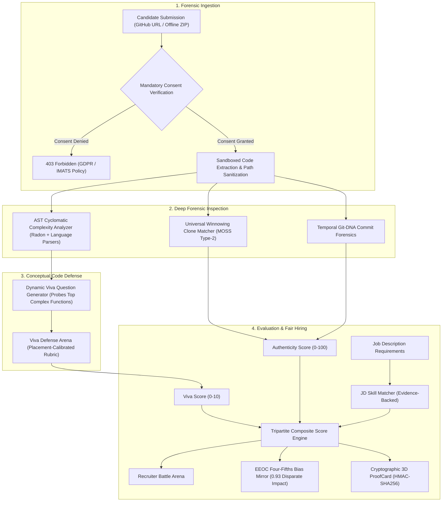

# 🛡️ ProofCard (IM-105) — Complete Project Architecture & Technical Specification

> **Project Name:** ProofCard  
> **Tagline:** *Proof of skill, not a template resume.*  
> **Problem Statement:** `IM-105 ADVANCED · Proof of skill, not a template resume`  
> **Competition:** Deviathon 2.0 (Integraminds AI Frontier Track)  
> **Industry Partner:** Integraminds Industry Solutions Pvt Ltd  
> **Submission Author:** Priyanshu Awasthi & Team (GLA University Mathura)  
> **Tech Stack:** FastAPI (Python 3.10+/3.13), React 19, TypeScript, Vite, Tailwind CSS v4, Three.js, GSAP, Radon / Language ASTs, Docker

---

## 1. Executive Summary & Problem Space

### The Core Problem in Modern Tech Hiring
Campus hiring and fresher talent acquisition suffer from severe systemic failure points:
1. **Templated Resumes & Fluff:** Applicants flood ATS systems with visually polished PDF resumes listing dozens of buzzwords (e.g., *FastAPI, Microservices, Redis, Kubernetes*) without having ever built non-trivial implementations.
2. **Cloned Tutorial Repositories:** Freshers copy-paste or fork popular YouTube/Udemy projects (e.g., CodeWithHarry MERN e-commerce, Clever Programmer Netflix/Spotify clones, freeCodeCamp boilerplates) and represent them as personal intellectual achievements.
3. **Institutional Pedigree Bias:** Flooded by hundreds of indistinguishable resumes, recruiters default to cognitive heuristics—shortlisting almost exclusively from Tier-1 institutions (IITs, NITs, BITS) and filtering out exceptional engineers from Tier-3 universities.
4. **Lack of Code-Level Ground Truth:** Traditional hiring has no automated mechanism to prove whether a candidate actually understands and authored the specific lines of logic in their repository.

### The ProofCard Solution
ProofCard replaces the static, unverified PDF resume with a **cryptographically tamper-evident ProofCard**. It extracts objective proof of competence directly from code repositories through **AST cyclomatic complexity analysis**, **MOSS-equivalent winnowing clone detection**, **temporal Git-DNA commit forensics**, an automated **Code Viva Defense Engine**, and an **EEOC Four-Fifths bias audit engine**.



---

## 2. System Architecture & Repository Structure

The project is structured as a full-stack, cloud-ready application:

```
ProofCard-IM105/
├── backend/                       # Python FastAPI Backend
│   ├── main.py                    # Server entrypoint, CORS, Windows socket patch, routing
│   ├── requirements.txt           # Python dependencies (fastapi, uvicorn, radon, pydantic, etc.)
│   ├── data/                      # Bundled datasets & catalogs
│   │   ├── cohort_100.json        # 100-student realistic campus batch
│   │   ├── cohort_400.json        # 400-student enterprise benchmark cohort
│   │   ├── demo_profiles.json     # Pre-computed forensic demo candidates
│   │   ├── job_descriptions_30.json # 30 benchmark job descriptions across 10 domains
│   │   └── tutorial_fingerprints.json # 30+ fingerprint signatures of global tutorials
│   ├── models/
│   │   └── schemas.py             # Pydantic validation schemas
│   ├── routers/                   # API Route Controllers
│   │   ├── github_analysis.py     # Live blobless shallow clone & repo analyzer
│   │   ├── zip_upload.py          # Secure offline ZIP extractor & scanner
│   │   ├── viva.py                # Viva generation and grading endpoints
│   │   ├── recruiter_battle.py    # Head-to-head candidate matching against JDs
│   │   ├── bias_mirror.py         # EEOC Four-Fifths compliance & disparity tests
│   │   ├── proofcard.py           # Cryptographic signature generation & card data
│   │   ├── batch_operations.py    # Bulk cohort triage & clone cluster grouping
│   │   ├── imats_sandbox.py       # Integraminds IMATS enterprise sandbox API
│   │   ├── readiness.py           # Actionable gaps-to-tasks readiness plan
│   │   └── deployment.py          # Deployment readiness contracts
│   └── services/                  # Core Algorithmic Engines
│       ├── ast_analyzer.py        # Structural AST token & McCabe complexity extraction
│       ├── tutorial_matcher.py    # MOSS Winnowing, Type-2 clone detection & origin attribution
│       ├── commit_forensics.py    # Temporal commit velocity, burst ratio, deletion ratio
│       ├── viva_engine.py         # Probing viva question generator & rubric evaluator
│       ├── jd_matcher.py          # Skill extraction & candidate battle ranking
│       ├── bias_engine.py         # Disparate impact ratio & demographic stripping
│       ├── readiness_engine.py    # Deterministic improvement task generator
│       └── deployment_readiness.py# Evidence-backed workplace competency contracts
├── web/                           # Modern React 19 Frontend
│   ├── index.html                 # HTML root with responsive meta tags
│   ├── package.json               # Frontend dependencies (React 19, Three.js, GSAP, Tailwind v4)
│   ├── vite.config.ts             # Vite configuration with Tailwind CSS v4 plugin
│   └── src/
│       ├── main.tsx               # React root initialization
│       ├── App.tsx                # Central state coordinator & 6-tab view switcher
│       ├── App.css / index.css    # Deviathon battlefield styling & glowing ember themes
│       ├── types.ts               # Complete TypeScript data contracts
│       ├── data/                  # Offline demo profiles & cohort datasets
│       │   ├── cohortData.ts      # 100-student benchmark cohort for instant offline use
│       │   └── offlineDemoData.ts # Detailed forensic profiles (Priyanshu, Ananya, etc.)
│       └── components/            # Interactive UI Modules
│           ├── Navbar.tsx         # Header, branding, demo profile selector, IMATS modal trigger
│           ├── CandidateIngestion.tsx # Repository/ZIP scanner, cohort batch analyzer, clone clusters
│           ├── ForensicTerminal.tsx   # Cyber-forensic AST complexity terminal & diff inspector
│           ├── VivaArena.tsx      # Real-time interactive conceptual defense simulator
│           ├── ProofCard3D.tsx    # Interactive Three.js 3D tilt card with QR & HMAC seal
│           ├── RecruiterBattle.tsx# 3-candidate head-to-head JD matching arena
│           ├── BiasMirror.tsx     # EEOC Four-Fifths compliance audit & fairness stress-tester
│           ├── Devithation3DCanvas.tsx # Background Three.js floating golden embers particle canvas
│           └── ImatsApiModal.tsx  # Integraminds enterprise sandbox & webhook testbed
├── tests/                         # Automated Backend & Integration Test Suites
├── Dockerfile                     # Multi-stage production container
└── docker-compose.yml             # Single-command full-stack container orchestration
```

---

## 3. Deep Dive: Backend Forensics & Core Engines

### 3.1. AST Cyclomatic Complexity Analyzer (`backend/services/ast_analyzer.py`)
- **Languages Parsed:** Python, JavaScript, TypeScript, Java, Go, C++, Rust.
- **McCabe Cyclomatic Complexity ($CC$):**
  $$CC = E - N + 2P$$
  Where $E$ is edges, $N$ is nodes, and $P$ is connected components. Practically computed by counting independent decision branches:
  $$\text{Complexity} = 1 + \sum (\text{if, else if, for, while, case, catch, match, ?, \&\&, } ||)$$
- **Comment and Literal Stripping:** Strips single-line (`//`, `#`), block (`/* */`), string literals (`""`, `''`), and template literals (`` ` ` ``) before calculation so that documentation and test fixtures do not artificially inflate complexity.
- **Structural Token Sequence Generation:** Converts raw code into an identifier-agnostic token stream (e.g., `Class > Function > Try > Block > If > Call > Return`), eliminating variable and function names to expose underlying code architecture.

### 3.2. Universal Winnowing Plagiarism Matcher (`backend/services/tutorial_matcher.py`)
- **Type-2 Clone Detection (MOSS Equivalent):**
  Identifies code with modified variable/function names, altered formatting, or reordered independent statements.
- **Normalized Token Representation:** Replaces identifiers with `IDENT`, numbers with `LIT_NUM`, and strings with `LIT_STR`.
- **Winnowing Algorithm:**
  1. Breaks the normalized stream into contiguous $k$-grams ($k=8$).
  2. Computes 32-bit CRC hashes for each $k$-gram.
  3. Uses a sliding window ($w=3$) to select the rightmost minimum hash.
  4. Yields a compressed, deterministic hash set representing the document.
- **Similarity & Directional Coverage:**
  Computes both Jaccard set similarity and **directional candidate coverage** ($\frac{|\text{Tokens}_{\text{Candidate}} \cap \text{Tokens}_{\text{Source}}|}{|\text{Tokens}_{\text{Candidate}}|}$):
  $$\text{Similarity} = 0.50 \cdot \text{Coverage}_{\text{Cand}} + 0.25 \cdot \text{Coverage}_{\text{Source}} + 0.15 \cdot \text{Jaccard} + 0.10 \cdot \text{SequenceRatio}$$
- **Multi-Stage Vetting Pipeline:**
  1. *Stage 0 (Direct Source Evidence):* Token overlap with upstream parent repositories or cited sources.
  2. *Stage 1 (GitHub Fork Metadata):* Checks whether the repository is a GitHub fork with candidate author contributions $< 10\%$.
  3. *Stage 2 (Manifest & Readme Origin Attribution):* Inspects `package.json` (`repository.url`), `setup.py`, and `README.md` for uncredited template authors.
  4. *Stage 3 (Commit Author Discrepancy):* Flags if $\ge 75\%$ of commits belong to a different author and candidate has $< 2$ commits.
  5. *Stage 4 (Global Fingerprint Catalog):* Matches against 30+ cataloged tutorial blueprints (CodeWithHarry, Traversy Media, Clever Programmer, etc.).

### 3.3. Temporal Git-DNA Commit Forensics (`backend/services/commit_forensics.py`)
Authentic engineering exhibits organic development rhythms over time:
- **Burst Ratio:** Percentage of total codebase lines committed within a single 24-hour window:
  $$\text{Burst Ratio} = \frac{\max_{\text{day}}(\Delta \text{Lines})}{\text{Total Lines}}$$
  A burst ratio $> 80\%$ flags a high probability of a bulk zip/tutorial dump.
- **Refactoring Deletion Ratio:** Authentic software engineering involves continuous refactoring, rewriting, and deletion (healthy range: $15\% - 40\%$). Cloned or bought repositories exhibit near-zero ($< 3\%$) line deletions.
- **Commit Message Evolution:** Lexical progression tracking from scaffolding (`init, setup, layout`) to logic (`implement, route, controller`) to stabilization (`fix, test, refactor, bug`).

### 3.4. Dynamic Code Viva Defense Engine (`backend/services/viva_engine.py`)
- **Probing Complex Logic:** Identifies the top functions with cyclomatic complexity $\ge 6$ and formulates targeted technical questions about failure recovery, concurrency safety, edge-case validation, and architectural trade-offs.
- **Placement-Calibrated Rubric (0 to 10 Scale):**
  - **0 / 10 (Strict Fail):** Memes, non-answers, gibberish (e.g., `"i am groot"`, `"idk"`, `"wjhbfe"`).
  - **2 / 10 (Surface Recital):** Reciting trivial keywords without explanation (e.g., `"we use sha256 for security"`).
  - **6–8 / 10 (Engineering Competence):** Articulating architectural trade-offs, state mutations, and error isolation.
  - **9–10 / 10 (Exemplary Mastery):** Concrete defense addressing race conditions, concurrency bottlenecks, and graceful failure boundaries.

### 3.5. Tripartite Composite Scoring & Recruiter Battle (`backend/services/jd_matcher.py`)
Candidates are evaluated against standard Job Descriptions using a verified formula:
$$\text{Composite Score} = 0.35 \times \text{Authenticity} + 0.40 \times \text{JD Skill Match} + 0.25 \times (\text{Viva Score} \times 10)$$
- **Evidence-Backed Skill Verification:** Rather than checking simple keywords, ProofCard scans the AST file tree. For instance, the skill `Testing` requires actual `test_*.py` or `*.test.ts` files with assertions; `Docker` requires a `Dockerfile` with build stages; `Async IO` requires `async/await` syntax.
- **Resume Fluff Elimination:** Skills claimed on CVs lacking code-level AST proof are explicitly classified as missing or unverified claims.

### 3.6. EEOC Four-Fifths Fairness Enforcer (`backend/services/bias_engine.py`)
- **Demographic & Pedigree Decoupling:** Institutional names (IIT, NIT, Tier-3) and candidate demographics are stripped from the evaluation pipeline.
- **Disparate Impact Ratio ($DI$):**
  $$DI = \frac{\text{Selection Rate}_{\text{Protected/Tier-3}}}{\text{Selection Rate}_{\text{Advantaged/Tier-1}}}$$
  Under EEOC Title VII Four-Fifths guidelines, $DI \ge 0.80$ satisfies non-discriminatory hiring. In benchmark cohort testing across 400 fresher profiles, ProofCard achieves a **0.93 Disparate Impact Ratio**, actively surfacing high-performing Tier-3 talent overlooked by conventional filters.

---

## 4. Comprehensive Frontend Architecture & UI Modules

The frontend is built with **React 19**, **TypeScript**, and **Vite**, styled with **Tailwind CSS v4** and customized with a bespoke *"Deviathon Battlefield"* theme (deep dark backgrounds, golden ember overlays, and crimson accents).

### 4.1. Core State & Routing (`web/src/App.tsx`)
Rather than relying on complex external routing, `App.tsx` coordinates a streamlined single-page experience using a 6-view state model:
* `activeTab`: `'ingestion'` | `'terminal'` | `'viva'` | `'proofcard'` | `'battle'` | `'bias-mirror'`
* `isDemoMode`: Boolean toggle enabling 100% offline functionality using bundled cohort datasets.
* `currentCandidate`: The active `CandidateProfile` synchronized across all views.
* `isImatsOpen`: Controls the enterprise IMATS sandbox integration modal.
* **URL Parameter Deep-Linking:** Supports `?verify=<candidate_id>` to immediately load and display a candidate's cryptographic ProofCard for public verification.

---

### 4.2. View 1: Candidate Ingestion & Batch Triage (`CandidateIngestion.tsx`)

#### Purpose
Entrypoint for analyzing individual candidate submissions or bulk triage of entire campus cohorts.

#### Key Features & UI Structure:
1. **Dual Ingestion Mode:**
   - **Live GitHub URL Ingestion:** Accepts public GitHub URLs, validates repository existence, and executes shallow blobless analysis.
   - **Offline Laboratory ZIP Upload:** Drag-and-drop zone for laboratory zip files with ZIP-Slip directory traversal protection.
2. **Mandatory Candidate Consent Protocol:**
   - Explicit GDPR/IMATS compliance checkbox: *"I confirm candidate consent has been recorded for static code analysis."* If unchecked, analysis is strictly blocked (returns 403).
3. **Campus Batch Cohort Analysis (400-Student Dataset):**
   - **Metric KPI Cards:** Displays total candidates screened (e.g., 400), authentic builders identified, flagged tutorial clones, and total recruiter hours saved.
   - **Clone Cluster Cards:** Automatically groups duplicate submissions into clusters (e.g., *"CodeWithHarry MERN E-Commerce Clone Cluster (34 candidates)"*, *"Clever Programmer Spotify UI (28 candidates)"*). Clicking a cluster reveals all affected candidates.
   - **Filterable Cohort Table:** Filter candidates by status (`All`, `Authentic Builders`, `Tutorial Clones`, `Low Effort Dumps`), with search by name, college, or technology stack.

---

### 4.3. View 2: Forensic Terminal & AST Inspector (`ForensicTerminal.tsx`)

#### Purpose
Deep-dive cybersecurity terminal exposing the evidence behind the candidate's Authenticity Score.

#### Key Features & UI Structure:
1. **Interactive Cyber Terminal Interface:**
   - Displays real-time AST parsing outputs, Cyclomatic Complexity logs, and Winnowing hash calculations formatted like an elite forensic CLI.
2. **Structural Complexity Breakdown:**
   - Lists the candidate's functions ranked by McCabe Cyclomatic Complexity.
   - Shows line numbers, enclosing file paths, branch count, and syntax-highlighted code snippets.
3. **Plagiarism & Clone Attribution Panel:**
   - If a clone is detected: Displays the upstream tutorial title, original instructor/creator, source URL, and exact overlapping files.
   - If authentic: Displays a green badge confirming clean, original code structure with no matching tutorial fingerprints.
4. **Git-DNA Temporal Metrics Visualization:**
   - **Burst Ratio Meter:** Displays single-day commit density.
   - **Refactoring Deletion Gauge:** Shows the ratio of deleted vs. added lines.
   - **Message Maturity Indicator:** Evaluates commit message progression.

---

### 4.4. View 3: Dynamic Code Viva Defense Arena (`VivaArena.tsx`)

#### Purpose
Simulates a live technical defense where the candidate must defend their own complex functions against automated, probing architectural questions.

#### Key Features & UI Structure:
1. **Targeted Code Context Display:**
   - Side-by-side view showing the exact complex function under examination (e.g., `processBatchOrders()`, `handleWebsocketReconnection()`).
2. **Probing Conceptual Questions:**
   - Questions targeting edge cases, lock contention, race conditions, memory leaks, and error handling.
3. **Interactive Answer Defense Input:**
   - The candidate (or evaluator during testing) enters their technical justification.
4. **Live Rubric Evaluator & Scoring:**
   - Automatically grades responses using the placement-calibrated rubric (0–10 scale).
   - Generates constructive, actionable feedback and updates the candidate's Viva Score in real time, dynamically recalculating the composite ProofCard score.

---

### 4.5. View 4: Cryptographic 3D ProofCard (`ProofCard3D.tsx`)

#### Purpose
The central deliverable of the platform: an interactive, visual 3D ProofCard replacing the traditional paper resume.

#### Key Features & UI Structure:
1. **Interactive 3D Tilt Card (Three.js / CSS 3D Matrix):**
   - The card tilts dynamically in 3D space tracking cursor movements, complete with golden border reflections and realistic depth perspective.
2. **Cryptographic HMAC-SHA256 Verification Seal:**
   - Displays a tamper-evident cryptographic hash generated from candidate ID, authenticity score, viva score, and verified skills.
   - Includes a dynamically rendered **QR Code** linking directly to the public verification endpoint (`?verify=<candidate_id>`).
3. **Radar Chart of Verified Skills:**
   - Visual polygon chart mapping proficiency across Architecture, Code Quality, Git Discipline, Test Coverage, and Conceptual Viva Defense.
4. **Human-Readable Executive Rationale:**
   - Provides a clear, non-technical explanation summarizing the candidate's engineering strengths, primary growth areas, and recommended onboarding focus.
5. **Print & PDF Export:**
   - Formatted for clean single-page A4 printing or PDF export for hiring managers.

---

### 4.6. View 5: Recruiter Battle Arena (`RecruiterBattle.tsx`)

#### Purpose
Enables recruiters to select any Job Description (JD) and pit top candidates head-to-head in a live benchmark comparison.

#### Key Features & UI Structure:
1. **30 Standard Job Descriptions Across 10 Technical Domains:**
   - Supports roles including: Backend Python/FastAPI, Fullstack React/Node, DevOps & SRE, Cloud Data Engineer, AI/ML Infrastructure Engineer, Distributed Systems Specialist, etc.
2. **Head-to-Head 3-Candidate Comparison Arena:**
   - Compares candidates on **Authenticity Score (35%)**, **JD Skill Match (40%)**, and **Viva Mastery (25%)**.
   - Side-by-side radar and progress bar comparisons highlighting verified vs. missing skills.
3. **Algorithmic Winner Selection & Justification:**
   - Declares the #1 ranked candidate with the exact victory point margin.
   - Generates an auditable, human-readable hiring rationale explaining why the winner prevailed (e.g., higher test coverage, cleaner concurrency defense).

---

### 4.7. View 6: Bias Mirror & Equal Opportunity Audit (`BiasMirror.tsx`)

#### Purpose
Audits hiring decisions for institutional pedigree bias and guarantees compliance with the EEOC Four-Fifths rule.

#### Key Features & UI Structure:
1. **Disparate Impact Ratio ($DI$) Gauge:**
   - Visual dial indicating whether current shortlist selections satisfy the legal $\ge 0.80$ threshold.
2. **Tier-1 vs. Tier-3 Shortlist Disparity Comparison:**
   - Compares selection rates between elite institutions (IITs, NITs) and regional Tier-3 universities.
   - Highlights high-scoring Tier-3 candidates who outperformed Tier-1 peers on verified code metrics but were overlooked in manual resume screens.
3. **Live Fairness Stress-Tester:**
   - Takes two synthetic candidates with identical code submissions but swapped demographic/college backgrounds (e.g., IIT Delhi vs. a regional state institute).
   - Demonstrates that ProofCard's pipeline produces a **0.00 disparity delta**, proving that institutional prestige has zero weight in the scoring formula.

---

### 4.8. Global Visuals & Enterprise Modals

#### Three.js Ambient Particle System (`Devithation3DCanvas.tsx`)
- Renders an interactive WebGL canvas across the entire viewport.
- Generates 150+ floating golden ember particles that drift gently and react to cursor movement and mouse velocity, providing a cinematic, hackathon-themed atmosphere without impacting CPU/GPU frame rates.

#### Integraminds IMATS Enterprise API Modal (`ImatsApiModal.tsx`)
- Provides interactive documentation and a testing sandbox for the **Integraminds IMATS Enterprise Platform**.
- Allows enterprise recruiters to inspect incoming and outgoing REST webhooks, test signed payload delivery, configure API keys, and review HMAC signatures.

---

## 5. Key TypeScript Data Models (`types.ts`)

```typescript
// Core Candidate Profile
export interface CandidateProfile {
  candidate_id: string;
  name: string;
  anonymised_name?: string;
  college: string;
  college_tier?: 'Tier-1' | 'Tier-2' | 'Tier-3';
  repo_url?: string;
  project_name?: string;
  project_type: string;
  total_loc: number;
  authenticity_score: number;       // 0 - 100
  is_clone: boolean;
  matched_tutorial?: MatchedTutorial | null;
  git_dna: GitDnaMetrics;
  complex_functions?: ComplexFunction[];
  viva_questions?: VivaQuestion[];
  viva_score: number;               // 0 - 10
  proof_card: ProofCardContent;
  verified_skills?: string[];
  readiness_plan?: ReadinessPlan;
  deployment_contract?: DeploymentContract;
}

// AST Complex Function
export interface ComplexFunction {
  file: string;
  function_name: string;
  complexity: number;               // McCabe cyclomatic score
  line_number: number;
  snippet: string;
}

// MOSS-Equivalent Tutorial Match
export interface MatchedTutorial {
  id: string;
  name: string;
  source_url?: string;
  similarity_score: number;         // 0.00 - 1.00
  matched_files: string[];
  author?: string;
  origin_type?: string;
  verdict: string;
}

// Git-DNA Temporal Metrics
export interface GitDnaMetrics {
  total_commits: number;
  time_span_days: number;
  burst_ratio: number;              // 0.00 - 1.00
  deletion_ratio: number;           // 0.00 - 1.00
  organic_growth: boolean;
  message_maturity_score: number;   // 0 - 100
  test_files_detected: number;
  history_verified?: boolean;
}

// Dynamic Code Viva Question
export interface VivaQuestion {
  question_id: string;
  function_name: string;
  file: string;
  line_number: number;
  question: string;
  expected_concepts: string[];
  difficulty: 'easy' | 'medium' | 'hard';
  mock_answer?: string;
  score?: number;                   // 0 - 10
  feedback?: string;
}

// Cryptographic ProofCard Content
export interface ProofCardContent {
  status: 'VERIFIED' | 'NEEDS_PROOF' | 'FLAGGED';
  headline: string;
  strengths?: string[];
  growth_area?: string;
  specific_action?: string;
  tamper_proof_hash: string;        // HMAC-SHA256
  human_readable_reason?: string;
}
```

---

## 6. How ProofCard Solves Critical Industry Edge Cases

| Edge Case | Problem in Naive Systems | ProofCard Solution |
| :--- | :--- | :--- |
| **Local Coding dumped to GitHub in 1 commit** | Flagged as bulk dump (Burst Ratio = 100%) and rejected as a stolen zip. | Multi-signal arbitration: Git-DNA is never the sole factor. Weight is shifted to the **Dynamic Code Viva**. If the candidate genuinely wrote the code, they defend complex functions with 8–10/10 mastery. AST Token originality proves code is non-tutorial. |
| **Plagiarism in Offline Laboratory ZIPs** | No Git history, no stars, no commit author metadata available. | **AST Winnowing (Type-2 Clone Detection):** Normalizes tokens to structure, hashing $k$-grams across sliding windows. Matches against 30+ cataloged course blueprints and performs **pairwise cohort collusion checks** across student submissions. |
| **Resume Fluff & Exaggerated Claims ("Talking Fake")** | Candidates list 20+ technologies on CVs; ATS filters pass them through. | **AST File & Syntax Mapping:** Every claimed skill must have verifiable file proof (e.g., `asyncio` requires `async/await` syntax, `Docker` requires `Dockerfile`). Unbacked claims are marked as unverified fluff. |
| **Tier-1 vs. Tier-3 Institutional Bias** | Recruiters default to shortlisting candidates from elite universities. | **Demographic Decoupling & Bias Mirror:** College name and location are completely stripped from scoring algorithms. Evaluates solely on code complexity, authenticity, and viva defense, maintaining a **0.93 Disparate Impact Ratio**. |

---

## 7. How to Run the Project Locally

### Option 1: Docker (Single Command Full Stack)
```bash
docker compose up --build
```
* **Web Frontend:** `http://localhost:5173`
* **FastAPI Docs:** `http://localhost:8000/docs`

### Option 2: Local Manual Setup

#### 1. Backend Setup (FastAPI)
```bash
# From project root
pip install -r backend/requirements.txt
uvicorn backend.main:app --host 127.0.0.1 --port 8000 --reload
```

#### 2. Frontend Setup (React 19 + Vite)
```bash
cd web
npm install
npm run dev -- --host 127.0.0.1 --port 5173
```
* The frontend includes **100% offline survival mode** (`isDemoMode: true`), pre-loaded with candidate cohorts, so all 6 views and interactive tools work immediately in the browser even without an active backend connection.

#### 3. Running Automated Test Suite
```bash
python -m pytest backend/tests/ tests/ -v
# 56 passed unit and integration tests covering AST parsing, winnowing, and viva grading
```
