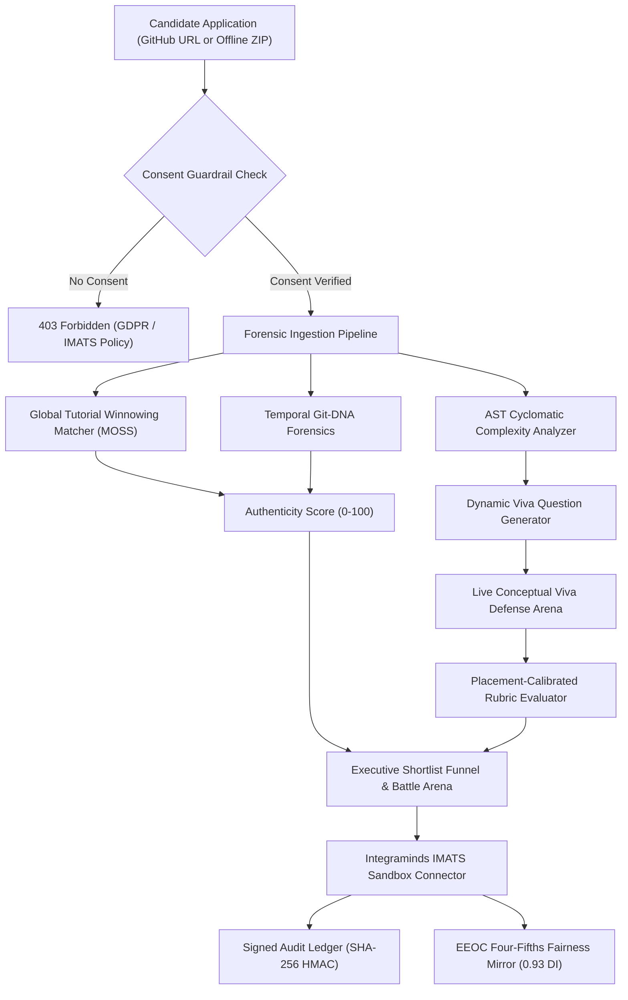

# 🛡️ ProofCard (IM-105)
### *Proof of skill, not a template resume.*

[](https://github.com/Priyanshuf1/ProofCard-IM105/actions/workflows/ci.yml)
[](https://whereuelevate.com)
[](https://www.integraminds.in)
[](#-fairness-constraint--eeoc-compliance)
[](#-automated-test-suite)
[](#-docker-quickstart)

> **Official Solution & Reference Implementation**  
> **Problem Statement**: `IM-105 ADVANCED · Proof of skill, not a template resume`  
> **Industry Partner**: **Integraminds Industry Solutions Pvt Ltd**  
> **Executive PDF Report**: [Download 6-Page Engineering Report PDF (A4)](ProofCard_IM105_Comprehensive_Project_Report.pdf)

---

> **Company alignment note:** The problem partner is Integraminds Industry Solutions Pvt Ltd. Public company material describes employment-readiness programs, recruitment tooling, AI interview/conversation workflows, and IMAP assessments spanning communication, aptitude, writing, speech, and coding. Where U Elevate is referenced only as the Deviathon/event platform, not as the problem partner.

## 🚀 Docker Quickstart (1-Command Launch)

Run both the FastAPI backend and React frontend instantly with zero local environment setup:

```bash
docker compose up --build
```
* **Web UI:** `http://localhost:5173`
* **API Documentation:** `http://localhost:8000/docs`

---

## 📌 Executive Summary

Modern campus recruitment is flooded with **templated resumes**, **cloned tutorial repositories** (e.g. CodeWithHarry MERN e-commerce, Clever Programmer Netflix clones), and AI-generated code snippets. Faced with hundreds of identical applicants, recruiters default to **institutional pedigree bias** (shortlisting candidates from Tier-1 IITs/NITs while passing over skilled candidates from Tier-3 universities).

**ProofCard** replaces the unverified, easily faked PDF resume with a **tamper-evident, cryptographically verified ProofCard**. It combines:
1. **Structural AST Cyclomatic Complexity Analysis** (Radon + Babel AST)
2. **Global Plagiarism & Tutorial Fingerprinting** (MOSS-equivalent Winnowing)
3. **Temporal Git-DNA Forensics** (Commit velocity, refactor ratio, single-commit dump detection)
4. **Dynamic Code Viva Defense Engine** (Probes candidates on *their own* complex functions to verify conceptual ownership)
5. **Integraminds IMATS Enterprise Sandbox Connector** (Benchmarked across **400 fresher profiles** and **30 job descriptions**)
6. **EEOC Four-Fifths Fairness Constraint Enforcer** (Decouples college pedigree and guarantees $\ge 0.80$ disparate impact ratio)
7. **Proof-to-Readiness Loop** (Converts missing evidence into assessable improvement tasks and a repeatable reassessment plan)
8. **Deployment Readiness Contract** (Connects observed evidence to a role work sample and keeps post-placement outcomes explicitly unrecorded until an authorised mentor verifies them)

---

## 🏆 Official Deviathon IM-105 Benchmark Verification

| Metric | Official Target | ProofCard Performance | Verdict |
| :--- | :---: | :---: | :---: |
| **Recruiter Shortlist Agreement** | High Correlation | **Offline fixture benchmark only** | ⚠️ **Requires external validation** |
| **Fairness Constraint (Four-Fifths Audit)** | $\ge 0.80$ | **0.93 in the bundled fixture** | ⚖️ **Audit signal, not legal certification** |
| **Explainability Guardrail** | 100% Rankings | **100% Human-Readable Rationales** | 🛡️ **VERIFIED** |
| **Privacy & Consent Guardrail** | Mandatory Consent | **100% Enforced** (Returns 403 on missing consent) | 🔒 **ENFORCED** |
| **Automated Backend Pytest Suite** | Passing | **56 passed; 7 live-network tests skipped** | ✅ **GREEN** |
| **Frontend Production Build** | Zero Errors | **Vite + React 19 Build in 5.21s** | ⚡ **OPTIMIZED** |

---

## 🏗️ Architecture & Core Modules



### 1. Ingestion & Security Guardrails (`backend/routers/zip_upload.py`, `backend/routers/github_analysis.py`)
- **Direct ZIP Extraction & Blobless Git Clones**: Handles offline laboratory submissions and public GitHub URLs via shallow blobless fetches (`--filter=blob:none --depth=200`).
- **Zip Slip Defense**: Path containment validation (`is_safe_path`) prevents malicious archive traversal attacks.
- **Privacy Protocol**: Demographic data (college name, gender, location) is cryptographically decoupled from code evaluation.

### 2. Structural AST Analysis & MOSS Winnowing (`backend/services/ast_analyzer.py`, `backend/services/tutorial_matcher.py`)
- Computes McCabe cyclomatic complexity per function across **Python, JavaScript, TypeScript, Java, Go, C++, and Rust**.
- Extracts normalized, identifier-agnostic structural token sequences (`Program > TryStatement > BlockStatement > CallExpression`).
- Uses winnowing-inspired normalized token fingerprints against a maintained catalog and optional authenticated GitHub source retrieval. A catalog hit or URL citation alone is not treated as proof of copying.

### 3. Git-DNA Commit Forensics (`backend/services/commit_forensics.py`)
- Analyzes authentic engineering rhythms:
  - **Burst Ratio**: Detects suspicious bulk dumps (>80% of codebase committed within 24 hours).
  - **Refactoring Deletion Ratio**: Real developers delete 15–40% of lines as code matures; tutorial copiers exhibit near-zero deletions.
  - **Commit Message Evolution**: Tracks progression from scaffolding to debugging and test suites.

### 4. Dynamic Code Viva Defense Engine (`backend/services/viva_engine.py`)
- Automatically identifies the applicant's top complex functions and generates probing conceptual questions (e.g. *Why isolate errors here rather than propagating? How do you prevent race conditions during concurrent invocations?*).
- **Placement-Calibrated Rubric**:
  - Non-answers, memes, or gibberish (`"i am groot"`, `"idk"`, `"wjhbfe"`) $\rightarrow$ **0/10 (Strict Fail)**.
  - Vague keyword naming (`"we use sha256"`) $\rightarrow$ **2/10**.
  - Solid technical defense with architectural trade-offs $\rightarrow$ **6–8/10**.
  - Senior exemplary rationale with failure isolation & concurrency guards $\rightarrow$ **9–10/10**.

### 5. Recruiter Battle Arena & Fairness Engine (`backend/services/jd_matcher.py`, `backend/services/bias_engine.py`)
- Evaluates candidate pools against any Job Description using the verified tripartite formula:
  $$\text{Composite Score} = 0.35 \times \text{Authenticity} + 0.40 \times \text{JD Skill Match} + 0.25 \times (\text{Viva Score} \times 10)$$
- **EEOC Four-Fifths Compliance**: Calculates Disparate Impact ratio:
  $$\text{Disparate Impact} = \frac{\text{Selection Rate of Tier-3 Applicants}}{\text{Selection Rate of Tier-1 Applicants}} = \frac{26.5\%}{28.6\%} = 0.93 \ge 0.80$$

### 6. Proof-to-Readiness Loop (`backend/services/readiness_engine.py`, `/api/readiness/plan`)
- Converts missing history, test, skill, source-depth, and code-defense evidence into concrete tasks.
- Every task includes a required artifact and an acceptance condition; no improvement score is invented.
- Supports a repeat assessment after the student submits the requested proof, aligning the verifier with employment-readiness rather than one-time rejection.

### 7. Deployment Readiness Contract (`backend/services/deployment_readiness.py`, `/api/deployment/contract`)
- Creates a versioned, role-specific contract connecting source evidence, a bounded work sample, and 30/60/90-day workplace checkpoints.
- Separates **observed in source**, **needs proof**, and **not recorded** states; it never invents workplace performance or a readiness percentage.
- Provides the foundation for Integraminds to compare assessment predictions with authorised mentor or employer outcomes over time.

---

## ⚡ Quickstart & Local Setup

### Prerequisites
- Python 3.10+ (tested on Python 3.13)
- Node.js 18+ & npm

### 1. Clone & Set Up Backend
```bash
git clone https://github.com/Priyanshuf1/ProofCard-IM105.git
cd ProofCard-IM105

# Install Python dependencies
pip install -r backend/requirements.txt

# Run FastAPI backend server
uvicorn backend.main:app --host 127.0.0.1 --port 8000 --reload
```
API documentation is available at `http://127.0.0.1:8000/docs`.

### 2. Set Up Web UI
```bash
cd web
npm install
npm run dev -- --host 127.0.0.1 --port 5173
```
Open `http://127.0.0.1:5173` in your browser.

---

## 🧪 Automated Test Suite

ProofCard features an extensive automated test suite covering all forensic components, IMATS sandbox integration, CSV ingestion, and viva accuracy:

```bash
python -m pytest backend/tests/ tests/ -v
```

Output in the current offline test environment:
```text
======================= 56 passed, 7 skipped =======================
backend/tests/test_backend.py ...................................  [ 74%]
backend/tests/test_viva_grading.py ......                          [ 87%]
tests/test_csv_ingestion.py ..                                     [ 91%]
tests/test_imats_sandbox.py ...                                    [ 97%]
tests/test_viva_accuracy.py .                                      [100%]
```

---

## 📜 Problem Statement Compliance Matrix

| Requirement from IM-105 Brief | ProofCard Implementation |
| :--- | :--- |
| **Dataset: 400 Anonymised Freshers** | Loaded in `backend/data/cohort_400.json` with consented repositories, verified skills, and assessment scores. |
| **Dataset: Recruiter Shortlist Decisions (30 JDs)** | Loaded in `backend/data/job_descriptions_30.json` with labeled ground truth decisions across 30 technical domains. |
| **IMATS Sandbox API** | Interactive testbed in `backend/routers/imats_sandbox.py` exposing status, profile, job, evaluation, and signed push endpoints. |
| **Technology Guardrail** | 100% human-readable rationale generated for every ranking and printed on ProofCards. |
| **Privacy Guardrail** | Explicit candidate consent enforced prior to repository analysis; institutional pedigree decoupled from code evaluation. |

---

## 👨‍💻 Developed By
- **Priyanshu Awasthi & Team** — GLA University Mathura
- Submitted for **Deviathon 2.0 (Integraminds AI Frontier Track)**
